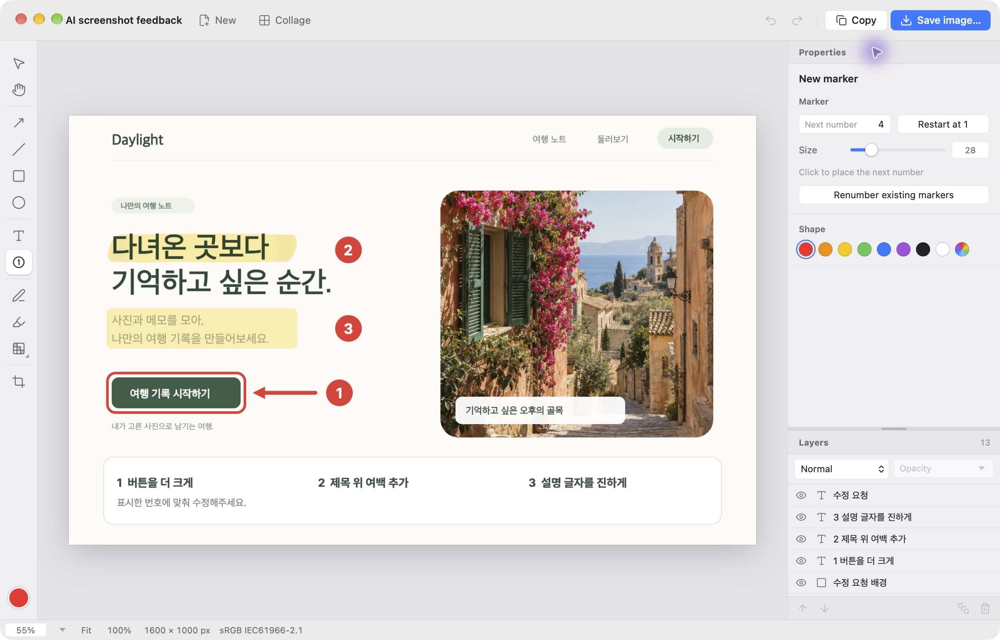
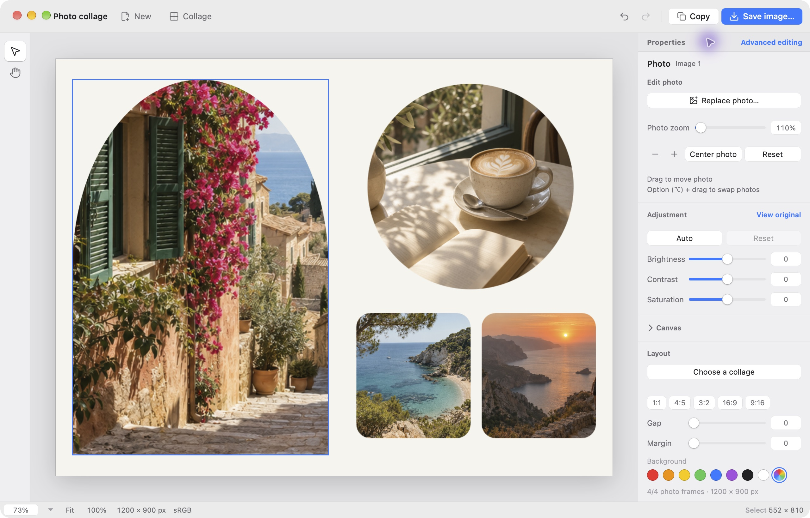
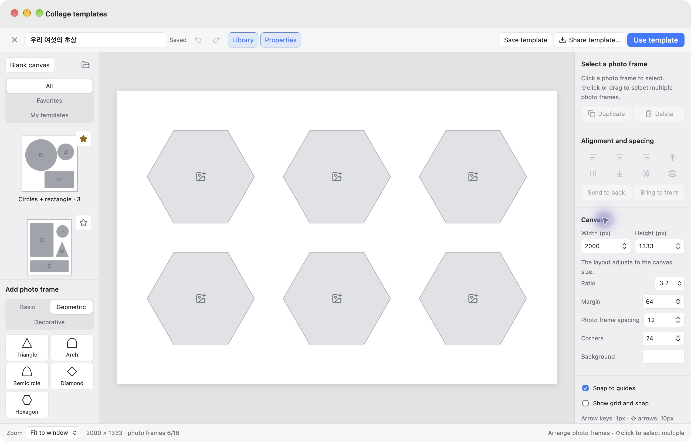

# Frame Zero

[한국어](#한국어) · [English](#english)

## 한국어

### 설명할 곳을 화면에 표시해요

캡처한 화면에 수정할 곳을 표시하고, “1번 버튼을 더 크게”, “표시한 부분을 확인해 주세요”처럼 위치를 짚어 설명해 보세요.

Frame Zero는 Mac과 Windows에서 쓰는 이미지 편집 앱이에요. 캡처한 화면에 화살표와 번호, 짧은 메모를 더해 보세요. AI에게 질문하거나 동료에게 피드백을 전할 때, 같은 곳을 보며 이야기하기 편해요.

[Mac용 다운로드 · 0.1.5](https://github.com/midnightai-apps/frame-zero/releases/download/macos-v0.1.5/Frame-Zero-0.1.5-arm64.dmg) · [Windows용 다운로드 · 0.1.1](https://github.com/midnightai-apps/frame-zero/releases/download/windows-v0.1.1/FrameZero.exe)

Mac: Apple Silicon · macOS 14 이상. Windows: Windows 11 x64 · Microsoft Edge WebView2 Runtime.

Windows 0.1.1에서는 화면 표시·이미지 저장과 기본 콜라주 배치를 사용할 수 있어요. 아래의 도형 콜라주·즐겨찾기·내 템플릿·템플릿 공유 안내는 Mac 0.1.5 기준이에요.

### 화면으로 먼저 살펴보세요

*샘플 내용을 담은 실제 Mac 0.1.5 앱 화면이에요.*

1. **이미지를 열어요.** 파일을 열거나 창에 끌어놓으세요. 캡처한 화면을 붙여넣어도 돼요.
2. **설명할 곳을 표시해요.** 왼쪽에서 화살표, 번호, 강조 표시를 고르고 가운데 화면에 더하세요. 오른쪽 속성에서 색과 크기를 조절해요.
3. **복사해서 AI 채팅에 붙여넣어요.** 오른쪽 위 복사 버튼을 누른 뒤, 채팅에 이미지를 직접 붙여넣고 “1번 버튼을 더 크게 해줘”처럼 질문해 보세요.

### 번호와 메모로 위치를 짚어요

수정할 곳이 여러 군데라면 번호를 붙여 보세요. 클릭할 때마다 다음 번호가 이어져요. 화살표로 위치를 짚고, 형광펜으로 중요한 부분을 표시하면 전달할 내용이 잘 보여요.

사각형이나 타원으로 영역을 둘러싸고, 펜으로 직접 그릴 수도 있어요. “여백 줄이기”, “문구 확인”처럼 짧은 글을 곁들이면 피드백이나 사용 안내를 한 장에 담기 좋아요.

### 공유 전에 필요한 부분만 남겨요

이미지를 자르고 밝기·대비·채도를 조절해 보세요. 화면 밖의 여백을 덜어 내거나 어두운 사진을 보기 편하게 다듬을 수 있어요.

이름이나 연락처처럼 가릴 부분에는 모자이크, 블러, 단색 가림을 적용할 수 있어요. 공유할 때는 PNG, JPEG, WebP로 저장한 결과 이미지를 확인해 주세요.

### Mac에서 여러 사진을 한 장에 모아요

*샘플 사진을 담은 실제 Mac 0.1.5 앱 화면이에요.*

여행 사진을 모으거나, 두 시안을 나란히 비교해 보세요. 콜라주에서 배치 미리보기를 고르고 사진을 넣으면 돼요. 사각형뿐 아니라 원, 삼각형, 아치처럼 다른 모양도 고를 수 있어요.

사진을 선택해 다른 사진으로 바꾸거나, 칸 안에서 보이는 위치와 확대 정도를 조절하세요. 자주 쓰는 배치는 즐겨찾기에 담고, 직접 저장한 배치는 내 템플릿에서 다시 꺼낼 수 있어요.

### Mac에서 마음에 드는 배치를 저장해 두세요

템플릿 편집기에서 캔버스의 가로·세로 크기와 사진 칸의 모양·크기를 정해요. 여백과 간격도 조절할 수 있어요. 원하는 배치를 내 템플릿으로 저장하면 다음 사진에도 다시 쓸 수 있어요.

배치를 다른 사람에게 건네고 싶다면 템플릿을 JSON 파일로 내보내세요. 가져온 파일은 내 템플릿에 새 복사본으로 추가돼요. **템플릿 파일에는 배치가 담기고, 사진은 들어가지 않아요.**

템플릿 편집 화면 보기

*샘플 배치를 담은 실제 Mac 0.1.5 앱 화면이에요.*

### 이어서 고칠 작업과 공유할 이미지를 따로 저장해요

적용한 편집 내용은 자동으로 저장돼요. 작업을 파일로 보관하려면 프로젝트로 저장하세요. `.imgproj` 프로젝트를 다시 열면 사진과 표시를 이어서 편집할 수 있어요.

AI 채팅이나 메시지로 보낼 때는 이미지를 복사하거나 PNG, JPEG, WebP로 저장하세요. 표시와 사진이 한 장으로 합쳐져요. **프로젝트에는 원본 사진이 포함되니, 정보를 가린 결과를 공유할 때는 완성한 이미지를 보내 주세요.**

### 설치와 업데이트

- **Mac:** Apple Silicon Mac과 macOS 14 이상이 필요해요. DMG를 열고 Frame Zero를 응용 프로그램 폴더로 옮겨 주세요. Mac 0.1.5에서는 사진 보관함에서 사진을 가져오거나, 사진 없이 새 캔버스를 만들어 시작할 수도 있어요.
- **Windows:** Windows 11 x64와 Microsoft Edge WebView2 Runtime이 필요해요. `FrameZero.exe`를 바로 실행하면 돼요. 별도로 설치할 필요는 없어요.

앱에서 새 버전이 있는지 자동으로 확인해요. 업데이트가 있으면 앱의 안내에 따라 진행해 주세요. 모든 다운로드와 버전별 변경 내용은 [릴리즈 페이지](https://github.com/midnightai-apps/frame-zero/releases)에서 확인할 수 있어요.

### 내 컴퓨터에서 편집해요

이미지 편집은 내 컴퓨터에서 처리해요. AI 채팅에 전달할 이미지는 직접 복사해 붙여넣어요.

Mac에서는 설정에서 한국어와 영어를 바꿀 수 있어요. 개인정보 처리방침, 오픈소스 고지와 관련 소스 파일도 Mac 앱의 설정에서 확인할 수 있어요.

---

## English

### Point to what you mean

Mark a screenshot and ask, “Make button 1 bigger” or “Check the highlighted area.”

Frame Zero is an image editor for Mac and Windows. Add arrows, numbers, and short notes to a screenshot. When asking AI a question or sharing feedback with a colleague, it's easier to talk about the same spot.

[Download for Mac · 0.1.5](https://github.com/midnightai-apps/frame-zero/releases/download/macos-v0.1.5/Frame-Zero-0.1.5-arm64.dmg) · [Download for Windows · 0.1.1](https://github.com/midnightai-apps/frame-zero/releases/download/windows-v0.1.1/FrameZero.exe)

Mac: Apple Silicon · macOS 14 or later. Windows: Windows 11 x64 · Microsoft Edge WebView2 Runtime.

Windows 0.1.1 supports screenshot annotations, image export, and basic collage layouts. The shaped collages, Favorites, My templates, and template sharing described below are available in Mac 0.1.5.

### Take a quick look

*An actual Mac 0.1.5 app screen with sample content.*

1. **Open an image.** Open a file, drag it into the window, or paste a screenshot.
2. **Mark the part you mean.** Choose an arrow, number, or highlight from the left and add it to the image. Adjust its color and size in Properties on the right.
3. **Copy it into your AI chat.** Click Copy at the top right, then paste the image into your chat yourself. Try asking, “Make button 1 bigger.”

### Add a number and a few words

Number the changes you want to discuss. Each click adds the next number. Use arrows to point to a spot and highlights to draw attention to a detail.

Outline an area with a rectangle or ellipse, or draw with the pen. A short note like “Less spacing” or “Check this wording” helps turn a screenshot into feedback or a quick guide.

### Keep the parts you want to share

Crop your image and adjust brightness, contrast, and saturation. Trim extra space or make a dark photo easier to see.

Use pixelation, blur, or a solid color to cover details such as names or contact information. Check the finished PNG, JPEG, or WebP image before sharing it.

### Bring photos together in one image on Mac

*An actual Mac 0.1.5 app screen with sample photos.*

Bring travel photos together or compare two designs side by side. Open Collage, choose a layout preview, and add your photos. Try circles, triangles, or arches alongside rectangular layouts.

Select a photo to replace it, move its visible area within the slot, or adjust its zoom. Keep layouts you use often in Favorites, and find your saved layouts in My templates.

### Save a layout for next time on Mac

In the template editor, set the canvas width and height, choose slot shapes and sizes, and adjust padding and gaps. Save the layout to My templates and reuse it with your next set of photos.

To share a layout, export the template as a JSON file. Importing a file adds a new copy to My templates. **Template files contain the layout, without photos.**

See the template editor

*An actual Mac 0.1.5 app screen with a sample layout.*

### Save a project to edit later, or an image to share

Applied edits are saved automatically. To keep your work as a file, save a project. Reopen the `.imgproj` project to continue editing its photos and annotations.

For an AI chat or message, copy the image or save it as PNG, JPEG, or WebP. The photos and annotations become one image. **Projects include the original photos, so share the finished image when you have covered personal details.**

### Install and update

- **Mac:** Requires an Apple Silicon Mac and macOS 14 or later. Open the DMG and drag Frame Zero into Applications. Mac 0.1.5 also lets you import from the Photos library or start with a new canvas without a photo.
- **Windows:** Requires Windows 11 x64 and Microsoft Edge WebView2 Runtime. Run `FrameZero.exe` directly. No installer is needed.

The app checks for updates automatically. Follow the in-app instructions when an update is available. See [Releases](https://github.com/midnightai-apps/frame-zero/releases) for all downloads and release notes.

### Edit on your computer

Image editing happens locally on your computer. When you want to send an image to an AI chat, copy and paste it yourself.

On Mac, switch between English and Korean in Settings. The Privacy Policy, open-source notices, and corresponding-source archives are also available in the Mac app's Settings.
